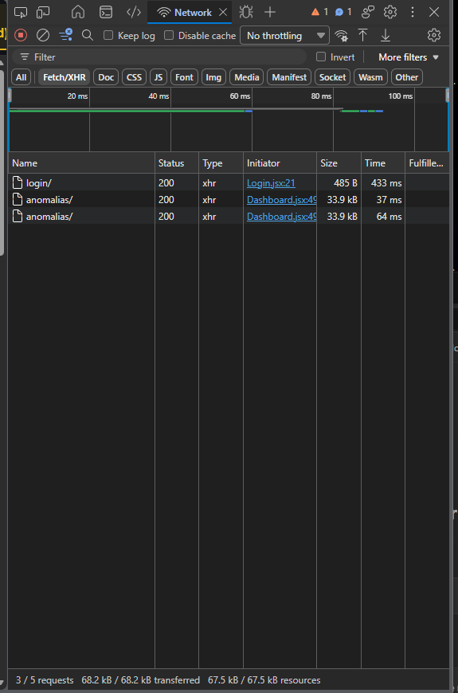

# Evidencias funcionales del Corte 6 - PluriOne

## Entorno de pruebas

Proyecto: PluriOne - Plataforma de Observabilidad de Datos con IA.
Version comprobada: 42a49d1.
Entorno: clon aislado del Corte 5, actualizado al Corte 6.
API: http://127.0.0.1:8005
Frontend: http://127.0.0.1:5176
Mailpit: http://127.0.0.1:8026
PostgreSQL: volumen independiente del proyecto original.

## Pruebas realizadas

1. Registro de usuario nuevo: correcto.
2. Recepcion del codigo de verificacion en Mailpit: correcta.
3. Activacion de cuenta: correcta.
4. Inicio de sesion sin recuperar contrasena: correcto.
5. Creacion del pipeline pipeline-corte6-latencia: correcta.
6. Envio de latencia_ms = 9500 a /metricas/externas: HTTP 201.
7. Alerta critica visible en el Dashboard: confirmada.
8. Registro de la anomalia en Historial, fila #8: confirmado.

## Resultado

El flujo funcional de autenticacion, ingesta de metricas
externas, deteccion y consulta de alertas fue comprobado
en el entorno aislado actualizado al Corte 6.

## Evidencia visual

Se obtuvieron capturas del registro, verificacion, inicio
de sesion, pipeline, Dashboard e Historial.

Pendiente: incorporar al repositorio capturas sin credenciales,
claves de ingesta ni otros datos sensibles.

## Limitaciones y pendientes

Esta demostracion utilizo un clon existente actualizado,
no una instalacion nueva desde cero del commit 42a49d1.

La causa exacta del HTTP 401 reportado anteriormente
no ha sido determinada mediante esta prueba.

Quedan pendientes las verificaciones finales de instalacion,
seguridad y los requisitos restantes de TODO Academy.

No se incluyen contrasenas, codigos ni claves de ingesta.

## Validacion adicional en main - 2026-10-29

### Entorno y version

- Repositorio: Diego-riveera02/G19X-TESE-DRA-122-ACADEMIC.
- Rama: main.
- Commit probado: fe51c53.
- Frontend React: http://127.0.0.1:5173.
- Backend FastAPI: http://127.0.0.1:8000.
- Mailpit: http://127.0.0.1:8025.
- PostgreSQL: contenedor Docker con estado saludable.

Esta validacion se realizo en el entorno local principal.
Es independiente de la prueba anterior del clon aislado
documentada para el Corte 6.

### Preparacion del correo

Se configuraron las siguientes variables en backend/.env:

- SMTP_SERVER=mailpit
- SMTP_PORT=1025
- SMTP_STARTTLS=false
- SMTP_AUTH=false

El archivo backend/.env permanece excluido del control de versiones.

Se recreo exclusivamente el contenedor api para aplicar
la configuracion. PostgreSQL y su volumen persistente
no fueron eliminados ni recreados.

La conexion SMTP desde FastAPI hacia Mailpit respondio
con codigo SMTP 220.

### Prueba funcional de autenticacion

Se realizo el siguiente procedimiento:

1. Registrar una cuenta ficticia nueva desde React.
2. Recibir el correo de verificacion mediante Mailpit.
3. Activar la cuenta utilizando el codigo recibido.
4. Iniciar sesion por primera vez sin recuperar ni cambiar
   la contrasena.
5. Comprobar el resultado HTTP desde las herramientas
   de desarrollo del navegador.
6. Confirmar el acceso al Dashboard de PluriOne.

Resultados observados:

| Comprobacion | Resultado |
| --- | --- |
| Registro de cuenta nueva | Correcto |
| Correo recibido en Mailpit | Correcto |
| Activacion de cuenta | Correcta |
| POST /login/ | HTTP 200 |
| Acceso al Dashboard | Correcto |
| Consultas de anomalías | HTTP 200 |

La captura muestra la solicitud login/ con HTTP 200
y dos consultas de anomalias con HTTP 200.
Durante la prueba se confirmo que el Dashboard
mostraba el nombre Diego Prueba PluriOne.
El nombre del usuario no aparece en la captura de red.

No se publican contrasenas, codigos de verificacion,
tokens JWT ni credenciales SMTP.

### Conclusiones y limitaciones

El error HTTP 401 reportado en una prueba anterior
no se reprodujo durante este primer inicio de sesion
sobre la version actual de main.

Esta prueba demuestra que el flujo funciona en el
entorno local utilizado, pero no establece con certeza
la causa historica del HTTP 401.

La aprobacion definitiva del criterio depende de la
reevaluacion de TODO Academy y de la evidencia exigida
por su rubrica.

### Captura del primer inicio de sesion

La captura permite verificar el resultado HTTP 200
sin mostrar contrasenas, codigos ni tokens.
