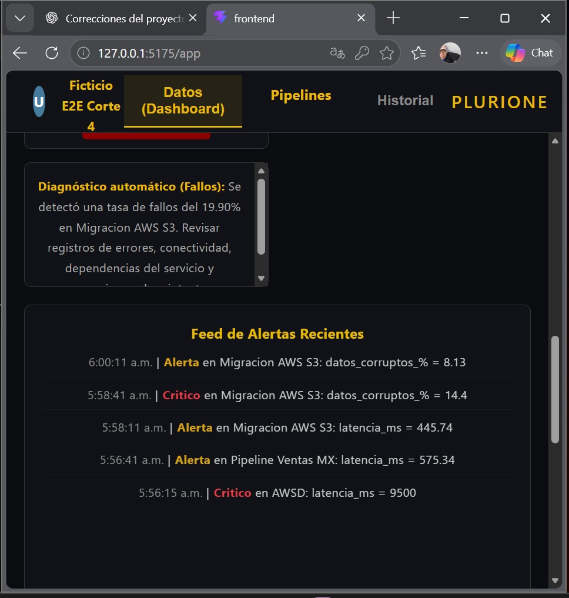

# Validacion funcional E2E desde clon aislado - Cuarto corte

## 1. Identificacion

- Proyecto: Plataforma de Observabilidad de Datos con Inteligencia Artificial.
- Empresa: PluriOne S.A. de C.V.
- Responsable: Diego Rivera Aguilar.
- Fecha: 25 de octubre de 2026.
- Commit base del clon: `1f7208a`.
- Commit de main al documentar: `3020014`.
- Resultado: prueba funcional E2E satisfactoria.

## 2. Objetivo

Comprobar la integracion de React, FastAPI y PostgreSQL
mediante autenticacion, pipelines, ingesta y visualizacion.

## 3. Entorno aislado

- Proyecto Docker: `plurione_readme_1253`.
- React: `http://127.0.0.1:5175`.
- FastAPI: `http://127.0.0.1:8002`.
- PostgreSQL: puerto local `5435`.
- Base de datos: `observabilidad_db` aislada.

Se utilizaron puertos alternativos para evitar conflictos.
Solo en el clon se autorizo temporalmente CORS para 5175.
Un Compose adicional configuro VITE_API_URL al puerto 8002.
Estos ajustes no se integraron al codigo oficial.

## 4. Autenticacion

Se registro una cuenta ficticia mediante FastAPI.
El usuario fue activado en la base aislada por falta de SMTP real.
Se verifico la emision de JWT y el inicio de sesion desde React.

## 5. Pipelines e ingesta

Se comprobo la administracion de pipelines desde React.
El pipeline utilizado para la ingesta satisfactoria fue `AWSD`.
La API autentico la solicitud con X-Pipeline-Key.

Endpoint: `POST /metricas/externas/`.

- Metrica enviada: `latencia_ms`.
- Valor enviado: `9500`.
- Respuesta HTTP: `201`.

El script inicialmente esperaba otro nombre de pipeline.
La solicitud se proceso, pero fallo esa comparacion posterior.
La consulta de PostgreSQL confirmo el registro correcto en AWSD.

## 6. Resultado en PostgreSQL

- Tabla: `anomaly_logs`.
- ID del registro: `32`.
- Pipeline: `AWSD`.
- Tipo: `latencia_ms`.
- Valor: `9500`.
- Estado: `Critico`.

## 7. Evidencia visual

El dashboard React mostro la alerta critica correspondiente:

`Critico en AWSD: latencia_ms = 9500`

## 8. Seguridad y limitaciones

- No se publicaron claves API ni tokens JWT.
- No se modifico la base de datos del proyecto original.
- SMTP y Groq utilizaron valores ficticios.
- No se verifico el envio real de correos.
- La cuenta ficticia se activo directamente en PostgreSQL.
- Se uso una adaptacion CORS temporal solo en el clon.
- No se ejecutaron pruebas automatizadas de navegador.
- No constituye una certificacion de produccion.

## 9. Conclusion

Se confirmo el flujo React - FastAPI - PostgreSQL.
La metrica externa se registro como anomalia critica
y aparecio correctamente en el dashboard del clon.
La prueba complementa la evidencia previa del cuarto corte.
