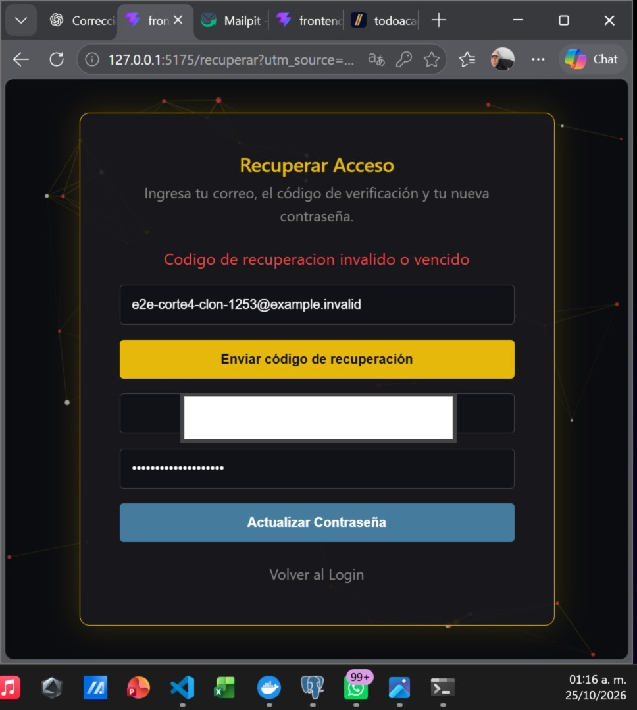

# Validación funcional de recuperación de contraseña con Mailpit

## 1. Identificación

- Proyecto: Plataforma de Observabilidad de Datos con Inteligencia Artificial.
- Empresa: PluriOne S.A. de C.V.
- Responsable: Diego Rivera Aguilar.
- Fecha de prueba: 25 de octubre de 2026.
- Corte académico: cuarto corte.
- Repositorio oficial al iniciar: main, commit 7c785ee.
- Entorno utilizado: clon independiente de PluriOne.

## 2. Objetivo

Verificar el flujo funcional de recuperación de contraseña
mediante React, FastAPI, PostgreSQL y un servidor SMTP de pruebas.

La validación incluye generación y entrega del código,
actualización de contraseña, inicio de sesión posterior,
rechazo de códigos reutilizados y caducidad.

## 3. Entorno aislado

- Proyecto Docker: plurione_readme_1253.
- React: http://127.0.0.1:5175.
- FastAPI: http://127.0.0.1:8002.
- Mailpit: http://127.0.0.1:8027.
- SMTP interno de pruebas: mailpit:1025.
- PostgreSQL: instancia aislada, puerto local 5435.

Mailpit permitió capturar correos sin enviarlos a Internet.
No se utilizaron credenciales personales de correo.

Se realizaron adaptaciones SMTP y CORS únicamente en el clon.
Estos ajustes no se integraron al código oficial.

## 4. Envío y recepción del código

Se solicitó un código de recuperación desde la interfaz React.
El correo de prueba apareció correctamente en Mailpit.
Se comprobó visualmente la disponibilidad del código.

La cuenta utilizada fue ficticia y pertenecía al entorno aislado.
No se documentan códigos de verificación ni contraseñas.

## 5. Actualización de contraseña

Se introdujo el código recibido en la interfaz React.
La aplicación confirmó la actualización de contraseña.
Después redirigió al formulario de inicio de sesión.

Se realizó un nuevo inicio de sesión con la contraseña
actualizada y se consiguió acceder correctamente.

Resultado: satisfactorio.

## 6. Reutilización del código

Se intentó utilizar nuevamente un código ya consumido.
La API aislada rechazó la solicitud con HTTP 400.

Resultado: se confirmó el rechazo del código reutilizado.

## 7. Caducidad del código

La vigencia configurada para recuperación era de 10 minutos.
Se realizó una comprobación manual esperando 11 minutos
antes de intentar utilizar el código desde React.

La interfaz mostró el siguiente mensaje de rechazo:

Código de recuperación inválido o vencido.

El resultado observado es compatible con la caducidad
configurada. La interfaz no distingue entre un código
incorrecto y uno vencido mediante mensajes separados.

## 8. Seguridad y limitaciones

- Se utilizaron exclusivamente cuentas ficticias.
- No se publicaron contraseñas ni códigos de recuperación.
- No se utilizaron credenciales SMTP personales.
- Mailpit capturó los mensajes dentro del entorno de pruebas.
- No se comprobó el envío mediante un proveedor SMTP real.
- No se modificó la base de datos del proyecto original.
- Las adaptaciones de configuración permanecieron en el clon.
- La caducidad se comprobó manualmente desde el navegador.
- No constituye una certificación de seguridad en producción.

## 9. Evidencia visual

Se observó el mensaje de rechazo en la interfaz React.
La captura incorporada tiene el código de recuperación completamente oculto.
Se conserva visible el mensaje de rechazo de React.

## 10. Conclusión

Las pruebas funcionales confirmaron que el entorno aislado
permite enviar un código a Mailpit, recuperar una contraseña
e iniciar sesión posteriormente con la nueva credencial.

También se observó el rechazo de un código reutilizado
y el rechazo después del período de caducidad configurado.

Estas pruebas amplían la evidencia funcional del cuarto corte.
